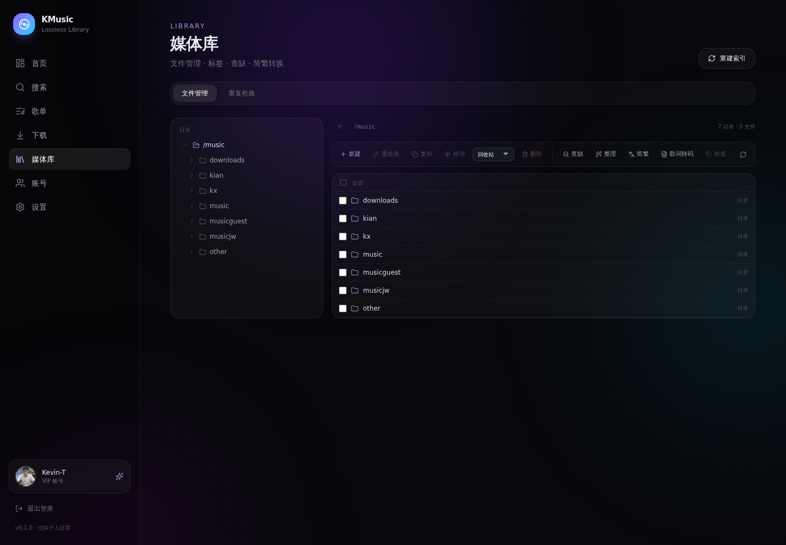
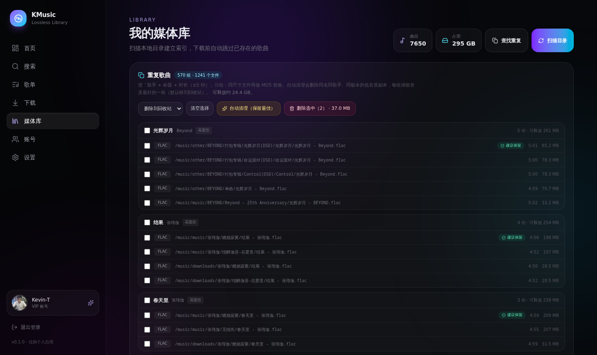
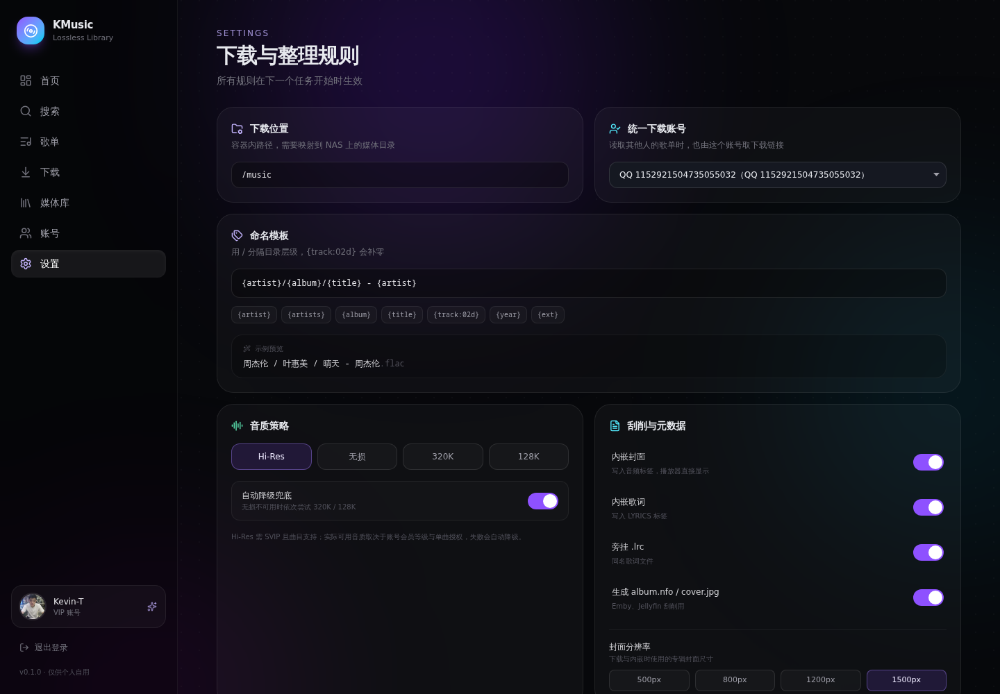
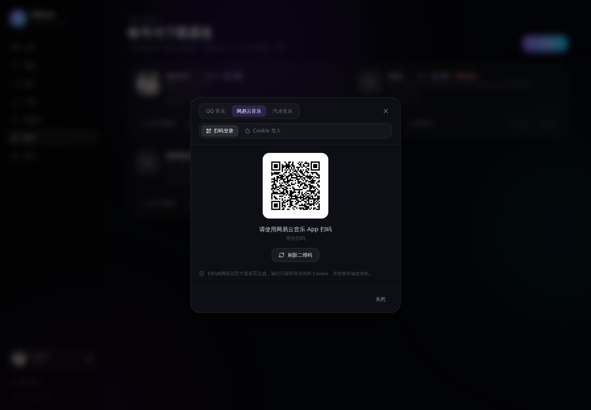

# KMusic

自建的音乐库下载与整理中心：一个 Web 界面聚合 **QQ 音乐 / 网易云 / 汽水音乐 / Apple Music** 的搜索、下载、刮削与在线播放，按你的命名规则落成 Emby、Jellyfin、Navidrome 能直接识别的音乐库。

> 仅供个人学习与自用，请使用自己付费的会员账号，下载内容请勿传播。

---

## 功能

### 多平台统一管线

| 平台 | 搜索 | 歌曲下载 | 专辑/歌单 | 账号方式 |
|---|---|---|---|---|
| QQ 音乐 | ✅ | ✅ FLAC / Hi-Res / 320K / 128K | ✅ | 扫码 / Cookie |
| 网易云音乐 | ✅ | ✅ | ✅ | 扫码 / Cookie |
| 汽水音乐 | ✅ | ✅ 会员完整版（standard） | 歌单 | 扫码 |
| Apple Music | ✅ 单曲/专辑/歌单/艺人 | ✅ ALAC / Dolby Atmos / AAC | ✅ 整张一次下 | wrapper 登录 |

- **合并搜索**：「全部」模式同时打多个平台，按平台筛选
- **统一下载管线**：命名模板、多音质降级、封面/歌词/NFO 刮削、去重、断点重试
- **已下载识别**：媒体库命中或下载记录命中直接标灰「已下载」，仍可点击强制重下
- **订阅追更**：歌单订阅后按间隔自动扫描新歌并入库
- **任务中心**：实时进度、单条重试/取消/清除、批量重试、失败记录一键清理

### Apple Music 完整方案

不是外链跳转，引擎与解密都在本机：

- **原生引擎**：内置 [`apple-music-dl`](https://github.com/zhaarey/apple-music-downloader)，配合 [`wrapper-lite`](https://github.com/worldobservationlog/wrapper-lite) 做 FairPlay 解密
- **三档独立目录**：ALAC 无损 / Dolby Atmos 全景声 / AAC 分别落盘，互不干扰
- **无损 + 全景声双下**：同一首歌两版都下时，各自进各自目录
- **无损转 FLAC**：ALAC 那版可再转成真正的 `.flac`（全景声保持 `.m4a`）
- **逐字歌词**：syllable/line 可选，LRC/TTML，内嵌 + 旁挂
- **曲库首页**：热门专辑 / 热门歌单 / 全景声空间音频专区 / 热门歌曲，30 秒试听
- **艺术家、专辑穿透**：榜单和歌单里点歌手名进艺人页、点专辑名进专辑页
- **在线播放**：全屏播放页（动态渐变背景 + 逐字滚动歌词 + 进度拖动 + 上一首/下一首）
- **失效曲目自动修复**：曲目下架换 ID 时，按「同名 + 同艺术家」重新匹配后再下载，绝不下载不同歌手的同名歌

### 界面

- 左侧图标导航栏 + 全局命令面板（`⌘K` / `Ctrl+K`）快速跳转与搜索
- 首页驾驶舱：今日/近 7 天/媒体库/占用统计、运行中任务、最近下载、账号贡献、扫描倒计时
- 设置中心：按用途分区（下载与存储 / 音质与性能 / Apple Music / 元数据与刮削 / 过滤），带未保存提示
- 程序日志：右上角实时查看服务端日志，支持暂停滚动、清空、关键词定位
- 媒体库文件管理：懒加载目录树、批量删除/移动/重命名、查缺补漏、重复歌曲扫描、简繁转换

## 界面截图

<p align="center">
  
  
</p>
<p align="center">
  
  
</p>

---

## 快速开始

### 方式一：Docker Compose（推荐）

```bash
git clone https://github.com/Kev1nT/KMusic.git
cd KMusic

cp .env.example .env
# 至少修改 ADMIN_PASSWORD，以及 MUSIC_HOST_DIR（宿主机音乐目录）

docker compose up -d
```

打开 `http://<your-host>:8090`，用 `ADMIN_PASSWORD` 登录。

首次启动会自动拉取镜像。想用本地源码构建：

```bash
bash scripts/fetch-engine.sh   # 下载 Apple 引擎（不用 Apple 可跳过）
docker compose build
docker compose up -d
```

### 方式二：源码开发

```bash
pnpm install
pnpm dev          # 前端 Vite + 后端 tsx 热重载
pnpm build        # 构建 server/dist 与 web/dist
```

要求 Node.js ≥ 20、pnpm ≥ 9、`ffmpeg`/`ffprobe` 可用。

---

## 环境变量

| 变量 | 默认 | 说明 |
|---|---|---|
| `ADMIN_PASSWORD` | `admin` | 后台登录密码，**务必修改** |
| `MUSIC_HOST_DIR` | `./music` | 宿主机音乐目录（映射到容器 `/music`） |
| `KMUSIC_PORT` | `8090` | 对外端口 |
| `PUID` / `PGID` | `1000` | 容器内运行用户，需与音乐目录属主一致 |
| `TZ` | `Asia/Shanghai` | 时区 |
| `KMUSIC_IMAGE` | `kev1nt/kmusic:latest` | 使用的镜像 |
| `APPLE_ID` / `APPLE_PASSWORD` | 空 | Apple Music 可选，见下节 |

---

## Apple Music 配置（可选）

Apple Music 走 `wrapper-lite` 做 FairPlay 解密，容器由 `docker-compose.yml` 一起拉起：

1. 在 `.env` 填入 `APPLE_ID` / `APPLE_PASSWORD`（真实密码，**不支持 App 专用密码**）
2. 首次启动需要 6 位双重认证码：把验证码写进 `./apple-wrapper/2fa.txt`，wrapper 会自动读取
3. 登录成功后会话缓存在 `./apple-wrapper/`，之后重启无需重新验证
4. 打开「账号」页 → Apple Music → 点「启用」

登录成功后可在这里调整：

- **三种落盘目录**：设置 → Apple Music → ALAC / Atmos / AAC 目录（想让无损并入主库就把 ALAC 目录设成 `/music`）
- **双下与转码**：无损 + 全景声双下、无损转 FLAC 开关
- **歌词粒度**：逐字 / 逐句，LRC / TTML

> ⚠️ 常见问题：Apple 账号有 **10 台设备上限**，超限时解密会失败（日志提示 `Device limit reached`）。到 `appleid.apple.com` 或设备的「设置 → Apple ID → 设备」里清理旧设备后，**重启 wrapper 容器**才会重新协商会话。

---

## 常见问题

**QQ 音乐登录态老是掉？**
QQ 的会话（`qqmusic_key` / `p_skey`）生命周期短，且同账号在手机/电脑登录会互踢。系统每 6 小时会自动保活并回写上游轮换的 Cookie；仍频繁失效的话建议单独用小号，或改用「导入 Cookie」方式登录。

**汽水音乐提示「仅返回试听片段」？**
- 非会员：服务端只下发 30 秒片段
- 会员仍提示：该曲目受版权/区域限制（多为海外版权），汽水即便会员也只给试听，建议换平台下载
- 汽水接口本身只提供未加密的 standard 档，拿不到无损

**下载失败提示「已下架或不可播放」？**
歌单里的旧曲目 ID 失效了。任务中心点「自动修复汽水曲目」，会按同名同艺术家重新匹配新 ID；匹配不到就保持失败，不会下错歌。

**媒体库里明明有文件却显示「未下载」？**
「已下载」判断依赖媒体库索引，去「媒体库 → 重建索引」扫一次即可。

---

## 目录结构

```
server/                 Fastify 5 后端
  src/providers/        各平台实现（qq / netease / qishui / apple）
  src/download/         下载管线、Apple 引擎封装、封面刮削、失效修复
  src/routes/           REST API
web/                    Vue 3 + Vite + Tailwind 前端
  src/pages/            页面（驾驶舱 / 搜索 / Apple / 媒体库 / 设置 …）
  src/components/       播放器、日志面板、命令面板等
docker/                 容器入口脚本
scripts/fetch-engine.sh 下载 Apple 引擎二进制
docs/                   截图与说明
```

---

## 免责声明

本项目仅用于个人学习与技术研究，请勿用于商业用途或传播受版权保护的内容。所有音源均来自第三方平台，使用者需自行承担合规责任，并建议只使用自己合法持有的会员账号。
